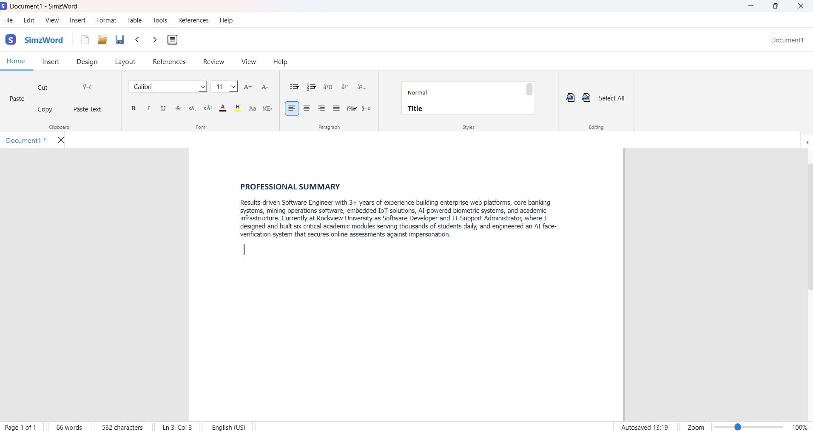

# SimzWord

**A Professional Desktop Word Processor Built with Python and PySide6**

SimzWord is a desktop word-processing application developed using Python and PySide6. It is designed to provide users with a professional document editing experience, offering document formatting, editing, organization, and export capabilities.

## Screen Shots




## Features

- **Rich Text Editing:** Create and format professional documents.
- **Text Formatting:** Customize fonts, font sizes, colors, highlighting, and paragraph alignment.
- **Document Management:** Work with multiple documents using tabs.
- **Tables:** Insert and manage tables within documents.
- **Images and Shapes:** Insert pictures and graphical elements.
- **Charts:** Add charts to documents.
- **Hyperlinks:** Insert clickable links.
- **Headers and Footers:** Customize document headers, footers, and page numbers.
- **Watermarks:** Add watermarks to documents.
- **Find and Replace:** Search for and replace text.
- **Spelling Tools:** Use spelling assistance and thesaurus features.
- **Word Count:** Track document word counts.
- **Printing:** Print documents and preview pages before printing.
- **Document Export:** Export documents to PDF, DOCX, and HTML.
- **Autosave and Recovery:** Help protect documents from unexpected interruptions.
- **Themes and Preferences:** Customize the application experience.

## Technologies Used

- Python
- PySide6
- Qt Framework

## Installation

### 1. Clone the Repository

```bash
git clone https://github.com/YOUR_USERNAME/SimzWord.git
```

### 2. Navigate to the Project Folder

```bash
cd SimzWord
```

### 3. Create a Virtual Environment (Recommended)

```bash
python -m venv venv
```

Activate it on Windows:

```bash
venv\Scripts\activate
```

### 4. Install Dependencies

```bash
pip install -r requirements.txt
```

### 5. Run SimzWord

```bash
python main.py
```

## Requirements

- Python 3.10 or later recommended.
- PySide6.

## Project Structure

```text
SimzWord/
│
├── main.py
├── requirements.txt
├── README.md
├── LICENSE
├── simzword_words.txt       # Optional dictionary
└── simzword_common.txt      # Optional dictionary
```

The dictionary files are optional. Include them if you want to distribute your custom dictionaries with the application.

## Project Status

SimzWord 1.0.0

The project is under active development, with future improvements planned for functionality, performance, and document compatibility.

## Developer

**William Siame**

GitHub: https://github.com/YOUR_USERNAME

## License

This project is licensed under the MIT License. See the `LICENSE` file for details.

---

*SimzWord – Professional document creation made simple.*